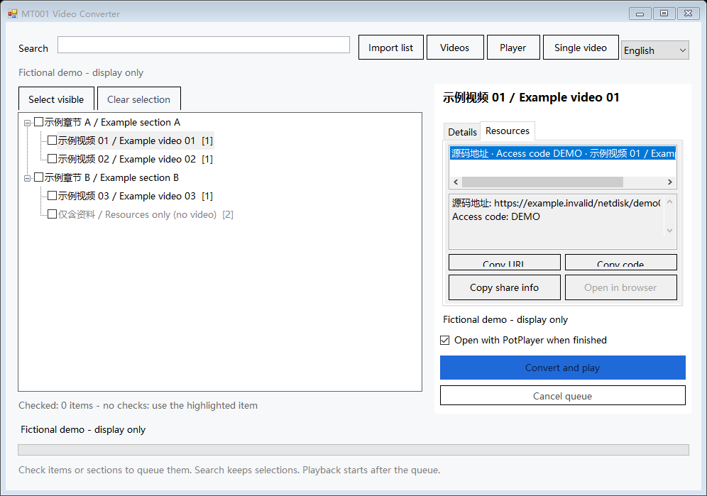
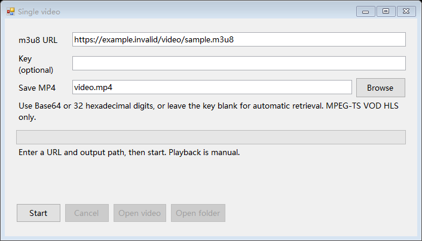

# MT001 Video Converter

A Windows desktop m3u8-to-MP4 converter with single-video conversion, batch lists, resource links, and optional PotPlayer playback.

[English](README.md) · [简体中文](README.zh-CN.md)

## Download and run

Download the complete portable ZIP from [Releases](https://github.com/Gsnow0123/MT001-m3u8-to-mp4/releases), extract it, and open `MT001-m3u8-to-mp4.exe`.

- Requires Windows 10/11 x64 and .NET Framework 4.8; no Python is needed.
- Keep `ffmpeg.exe` next to the application. The standalone EXE requires a separately supplied FFmpeg executable.
- Choose **English** in the top-right corner to switch the interface language. The preference is saved.

## Usage

- **Single video:** enter an m3u8 URL, an optional Base64 or 32-digit hexadecimal AES-128 key, and an MP4 output path. Leave the key blank to retrieve it from the URL specified by the playlist. Open the video or its folder manually after conversion.
- **Batch list:** import a UTF-8 text list and check videos or sections. Items are processed in list order; searching preserves selections, and individual failures do not stop the remaining queue. Optionally open completed videos with PotPlayer after the queue finishes.
- **Resources:** select an item and open the Resources tab to view its links and access codes, including resources inherited from parent sections. Copy a URL, an access code, or the complete share information, or open the link in a browser. Netdisk login and file downloads are not included.
- **Cancel and resume:** cancellation preserves verified segments. Start again with the same URL, key, and output directory to resume. Final MP4 files are saved only after lossless remuxing and full-file audio/video verification. Existing verified videos can be reused.




## List format

Lists are parsed as text only; their contents are never executed. Import `.txt` files or text lists with a `.java` extension. Tabs or spaces define the hierarchy, and `key` is optional.

Resource fields can use any label followed by an HTTP/HTTPS URL. They attach to the item at the corresponding indentation level. Access codes can be four alphanumeric characters after whitespace, explicit access-code text in the supported Chinese list format, or a `pwd` query parameter. Lists may also contain resources without videos.

```text
Example section
    Example video
        key-> AAAAAAAAAAAAAAAAAAAAAA==
        hls-> https://example.invalid/video/sample.m3u8
        Source code-> https://example.invalid/share/sample    DEMO
        Pre-reading-> https://example.invalid/reading/sample
    Resources only
        Other resources-> https://example.invalid/resources/sample?pwd=DEMO
```

The bundled demo is entirely fictional and display-only. `.invalid` is a reserved example domain, and the application blocks requests to these URLs. Import your own list or enter a real video URL to convert.

## Supported formats

- MPEG-TS VOD HLS, unencrypted streams or standard single-key AES-128, with explicit or media-sequence-derived IVs.
- Master playlists: the highest-bandwidth variant is selected. Relative URLs and redirected base URLs are supported.
- Four concurrent segment downloads, network retries, segment hash verification, resumable downloads, and full-file decoding for verification.
- Live streams, DRM, SAMPLE-AES, fMP4, BYTERANGE, separate audio tracks, and key rotation are not supported.

The bundled minimal FFmpeg covers H.264, HEVC, MPEG-2/MPEG-4 video and common AAC/MP2/MP3/AC3 audio. Other codecs may require a compatible FFmpeg build.

## Privacy and local files

There is no telemetry or upload feature. The application accesses only the videos you choose to convert, their playlist-specified keys and segments, or resource pages you explicitly open. New verification records do not contain source URLs or keys, and error logs redact URLs and sensitive parameters. Imported titles and resource names are preserved as-is rather than translated.

Default local locations:

| Content | Location |
| --- | --- |
| Converted videos | `mp4` |
| Settings | `settings.json` |
| Resumable segment cache | `.cache` under the output root |
| Batch playback lists | `mp4/.playlists` |

Input URLs and keys are not saved to settings. Personal lists, videos, settings, cached segments, and logs are excluded from the repository and release packages. All published examples and screenshots use fictional data.

## Build and test

```powershell
powershell -NoProfile -ExecutionPolicy Bypass -File .\src\Build.ps1 -Test -StageOnly
```

Uses the .NET Framework C# compiler supplied with Windows, with no NuGet dependencies. Place FFmpeg next to the project before running conversion tests. Tests generate synthetic videos and generic lists, using mocked URLs and loopback HTTP only; they do not read personal course lists.

Build artifacts are written to `.build`. Omit `-StageOnly` to update the local application.

The pinned FFmpeg source version and cross-compilation procedure are in `scripts/build-ffmpeg.sh`. GitHub Actions builds the Windows x64 executable. The portable package includes FFmpeg's complete corresponding source, licenses, and build records.

## License

This application's source is [MIT-licensed](LICENSE). FFmpeg runs as a separate LGPL-licensed executable. Its complete corresponding source, license, and build information are supplied in the portable package's `third-party` directory.

FFmpeg: [source](https://github.com/FFmpeg/FFmpeg) · [license information](https://ffmpeg.org/legal.html).
