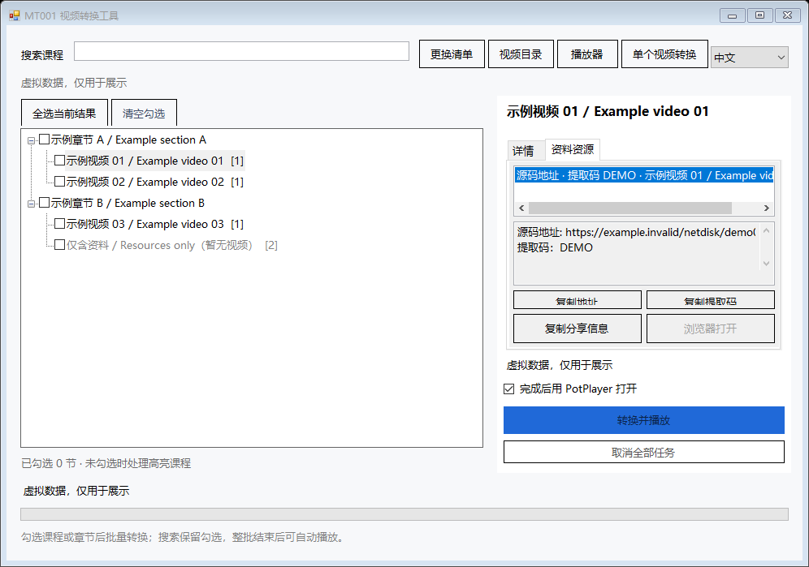
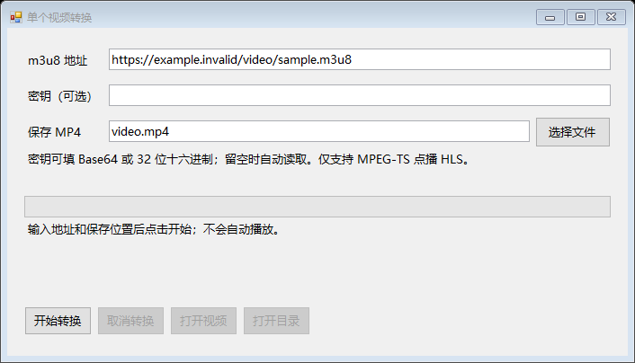

# MT001 视频转换工具

Windows 桌面 m3u8 转 MP4 工具，支持单个视频转换、清单批量转换、附带资料链接及可选的 PotPlayer 播放。

[English](README.md) · [简体中文](README.zh-CN.md)

## 下载与运行

从 [Releases](https://github.com/Gsnow0123/MT001-m3u8-to-mp4/releases) 下载完整便携 ZIP，解压后打开 `MT001-m3u8-to-mp4.exe`。

- 支持 Windows 10/11 x64，需要 .NET Framework 4.8，无需 Python。
- 保留同目录的 `ffmpeg.exe`。单独下载 EXE 时，请自行将兼容的 FFmpeg 放在旁边。
- 右上角可切换 **中文** 或 **English**，程序会记住语言选择。

## 使用

- **单个视频**：输入 m3u8 地址、可选的 Base64 或 32 位十六进制 AES-128 密钥，并选择 MP4 保存位置。密钥留空时，从播放列表指定地址读取。完成后可手动打开视频或所在目录。
- **清单批量转换**：导入 UTF-8 文本清单，勾选视频或章节，按清单顺序转换。搜索保留勾选，单节失败会继续处理后续条目。可选整批结束后用 PotPlayer 打开已完成的视频。
- **资料资源**：选择条目后切到资源页，查看当前条目及其上级的链接与提取码。支持复制网址、提取码、整条分享信息和在浏览器打开，不包含网盘登录或文件下载功能。
- **取消与续传**：取消时保留已校验分片，下次使用同一地址、密钥和输出目录可续传。正式 MP4 在无损封装及全片音视频校验通过后才保存，已有且验证有效的视频可直接复用。




## 清单格式

清单仅作为文本解析，不执行其中的内容。支持 `.txt` 和文本形式的 `.java` 文件，Tab 或空格表示层级，`key` 可选。

`源码地址`、`其他资料`、`课前预习`，以及其他包含 HTTP/HTTPS 地址的字段均可作为资料资源，按缩进附属于对应条目。提取码支持地址后以空白分隔的四位字母或数字、显式“提取码”文本及 `pwd` 查询参数。清单也可以只有资料而没有视频。

```text
示例章节
    示例视频
        key-> AAAAAAAAAAAAAAAAAAAAAA==
        hls-> https://example.invalid/video/sample.m3u8
        源码地址-> https://example.invalid/share/sample    DEMO
        课前预习-> https://example.invalid/reading/sample
    仅含资料
        其他资料-> https://example.invalid/resources/sample?pwd=DEMO
```

内置演示清单全部为虚构数据，仅用于界面展示。`.invalid` 是保留示例域名，工具禁止请求这些地址。导入自己的清单或输入真实视频地址后即可使用转换功能。

## 支持范围

- MPEG-TS 点播 HLS，未加密或标准单密钥 AES-128，支持显式 IV 和按媒体序号计算的 IV。
- 主播放列表默认选择最高带宽版本，支持相对地址和重定向后的基础地址。
- 4 个分片并发下载、网络失败重试、分片哈希校验、断点续传及全片解码校验。
- 暂不支持直播、DRM、SAMPLE-AES、fMP4、BYTERANGE、独立音轨或多密钥轮换。

便携包中的精简 FFmpeg 支持 H.264、HEVC、MPEG-2/MPEG-4 视频，以及常见的 AAC/MP2/MP3/AC3 音频。其他编码可能需要另行提供兼容的 FFmpeg。

## 隐私与本地文件

程序无遥测或上传功能，仅访问你明确转换的视频、播放列表指定的密钥与分片，或你主动打开的资料页面。新转换记录不包含原始网址或密钥，错误日志会隐藏地址和敏感参数。导入的条目标题和资源名称按原文显示，不自动翻译。

默认本地文件位置：

| 内容 | 位置 |
| --- | --- |
| 转换后的视频 | `mp4` |
| 设置 | `settings.json` |
| 续传分片缓存 | 输出根目录下的 `.cache` |
| 批量播放列表 | `mp4/.playlists` |

输入的视频地址和密钥不会保存到设置。个人清单、视频、设置、缓存和日志均不包含在源码仓库及发行包中，公开示例和截图全部使用虚构数据。

## 编译与测试

```powershell
powershell -NoProfile -ExecutionPolicy Bypass -File .\src\Build.ps1 -Test -StageOnly
```

使用 Windows 自带的 .NET Framework C# 编译器，无 NuGet 依赖。运行转换测试前，需要将 FFmpeg 放在项目目录。测试会生成合成短视频和通用清单，仅使用模拟地址与本机回环 HTTP，不读取个人课程清单。

构建产物位于 `.build`，去掉 `-StageOnly` 可更新本地程序。

FFmpeg 的固定源码版本与交叉编译流程位于 `scripts/build-ffmpeg.sh`，GitHub Actions 负责构建 Windows x64 版本。便携包包含其完整对应源码、许可证和构建记录。

## 许可证

本工具源码采用 [MIT 许可证](LICENSE)。FFmpeg 作为独立进程运行，采用其自身的 LGPL 许可证。便携包的 `third-party` 目录包含 FFmpeg 的完整对应源码、许可证和构建信息。

FFmpeg：[源码](https://github.com/FFmpeg/FFmpeg) · [许可说明](https://ffmpeg.org/legal.html)。
